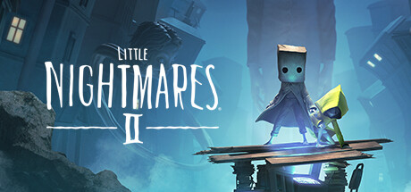

**Little Nightmares II follows Mono and Six escaping a Signal Tower broadcasting monstrous television signals in a decaying city. Features a companion mechanic, Mono's new ranged weapon throwing, and even more grotesque and disturbing antagonists than the original.**

---

## 📖 About

Little Nightmares II follows Mono and Six escaping a Signal Tower broadcasting monstrous television signals in a decaying city. Features a companion mechanic, Mono's new ranged weapon throwing, and even more grotesque and disturbing antagonists than the original.

## ⚠️ Problems Without Trainer

| Problem | Status |
|---------|--------|
| **Hunter Shotgun** — Opening forest section with pursuing Hunter has very tight dodge windows | ✅ Solved |
| **Teacher Ruler** — Long-neck Teacher's ruler attacks in school sections are relentlessly punishing | ✅ Solved |
| **Thin Man Chase** — Signal Tower sequences require perfect timing under extreme visual pressure | ✅ Solved |
| **Dark Environments** — Critical path objects blend into background making navigation confusing | ✅ Solved |

## ✅ Solution

The **Little Nightmares II Trainer** solves all these issues by giving you complete control over the game.

## 🎯 Full Feature List

- Unlimited Resources
- God Mode / Invincibility
- Instant Skill Cooldown
- One-Hit Kill
- Freeze Game Timer
- Unlock All Items & Achievements
- Custom Speed Multiplier
- Save State Anywhere

## 🚀 Quick Start

1. **Disable Windows Defender** temporarily (trainer may trigger false positive)
2. Download the trainer from the button above
3. Launch Little Nightmares II
4. Run the trainer as Administrator
5. Activate desired cheats with hotkeys

## 💎 Free vs Paid

| Feature | Free | Pro |
|---------|------|-----|
| Basic God Mode | ✅ | ✅ |
| Unlimited Resources | ✅ | ✅ |
| All Advanced Cheats | ❌ | ✅ |
| Auto-Updates | ❌ | ✅ |
| Priority Support | ❌ | ✅ |

## 💻 Requirements

- Windows 10/11 (64-bit)
- Little Nightmares II (any version)
- .NET Framework 4.8+
- DirectX 11+

## 🍎 macOS

macOS users can use our alternative tool:

## ⚖️ Legal

This trainer is for educational and single-player use only. Use responsibly.

---

